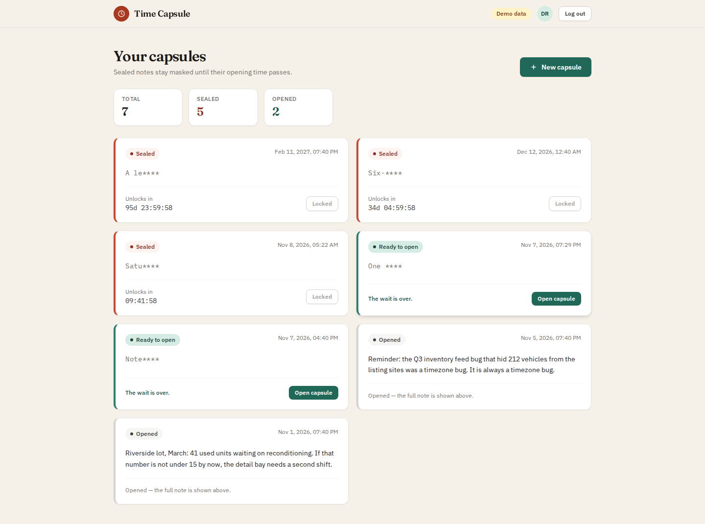
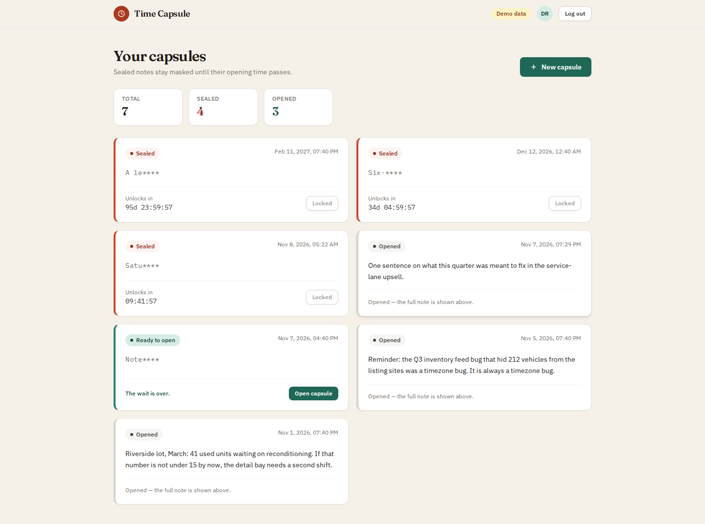
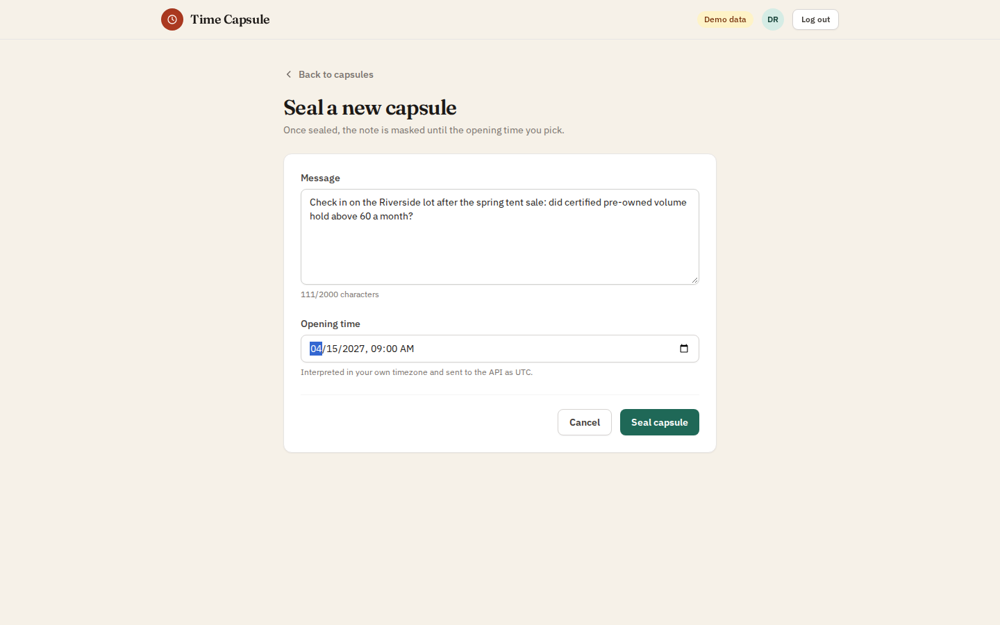
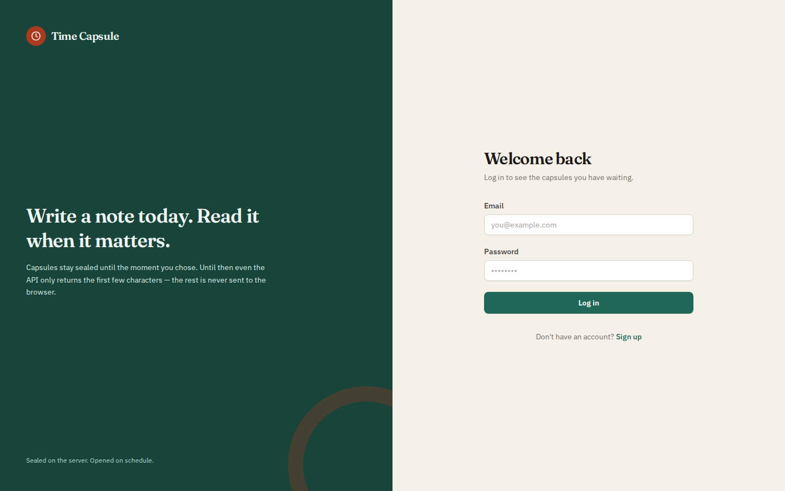
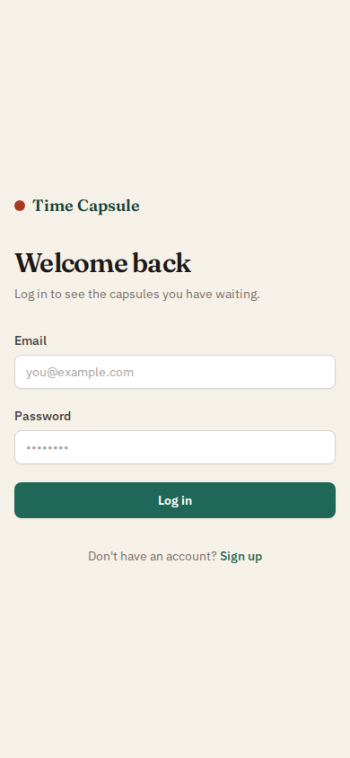
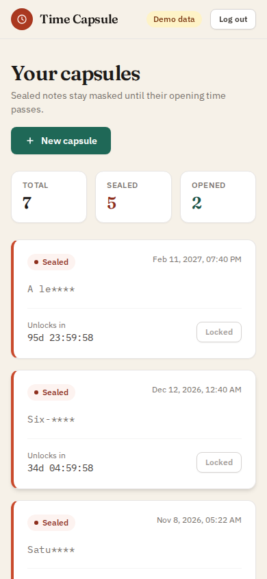
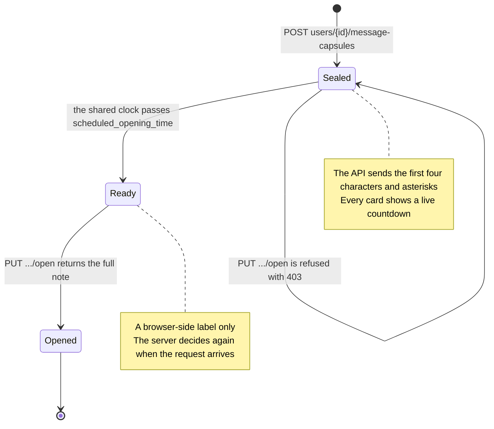
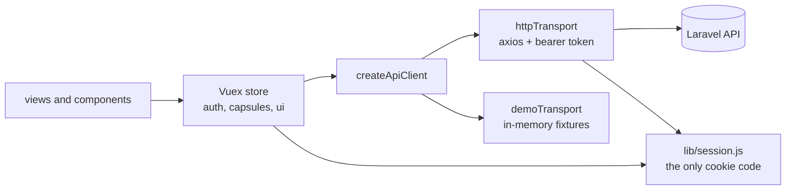

# Time Capsule: the Vue 3 client

Write a note to your future self, pick the moment it may be read, and the note
stays sealed until then. Sealing is enforced on the server: until the opening
time passes the API returns only the first four characters of the note, so the
rest never reaches the browser at all.

> **The directory name does not describe the app.** `package.json` has been
> `time-capsule-app` since the first commit, and the companion API is a time
> capsule API. Read `dealers-united-*` as the name of the exercise. The demo
> data plays along: it is a fictional dealer group's reminders to itself.

This repository is the frontend only: Vue 3, Vuex 4, Vue Router 4 and Tailwind
CSS, built and tested with Vite 8 and Vitest. It talks to the Laravel API in the
sibling `dealers-united-backend` repository. Fortify issues a Sanctum token, and
every request after that sends it as a bearer header.

## What it looks like

Every image was captured with Playwright against the demo build (the in-memory
transport described below), at 1440x900 and 390x844. The header carries a
"Demo data" badge, and every name and figure in the notes is made up.

| The list: sealed, ready and opened capsules side by side |
| --- |
|  |

| One click later: Sealed 5 -> 4, Opened 2 -> 3 |
| --- |
|  |

| Sealing a new capsule |
| --- |
|  |

| Sign-in | Sign-in at 390px | The list at 390px |
| --- | --- | --- |
|  |  |  |

The look is meant to suggest an archive of sealed letters: a paper background,
deep green for anything ready or primary, sealing-wax red for anything still
locked, Fraunces for headings, IBM Plex Sans for text and IBM Plex Mono for the
countdowns and masked notes.

## Run it

### With Docker (no Node needed)

Demo mode needs no backend. An in-memory transport stands in for HTTP,
including the masking rule and the 403:

```bash
VITE_DEMO=true docker compose up --build
# http://localhost:8640   (any non-empty email and password signs you in)
```

To run against a real API instead, set the URL at build time:

```bash
VITE_API_BASE_URL=https://api.example.com/api/v1/ docker compose up --build
```

The image is a three-stage build (`npm ci`, then `vite build`, then nginx). It
runs as the unprivileged `nginx` user on a read-only filesystem and exposes a
`/healthz` check that Compose polls.

### With Node 22

`.nvmrc` and `engines` both ask for Node 22 (Vite 8 needs 22.12 or newer).

```bash
npm install
npm run dev:demo       # http://localhost:8080, fixture data
```

Against a running backend:

```bash
cp .env.example .env   # point VITE_API_BASE_URL at your backend
npm run dev
```

## A capsule has three states



Only two of those states exist in the API's data. `is_opened` is the only field
of a capsule that ever changes. **Ready is the client's reading of the clock.**
`CapsuleCard` compares `scheduled_opening_time` against the shared ticker and
enables the button, while the server checks again and answers `403` if the
browser was optimistic. The disabled button is a courtesy; the 403 is the rule.

The countdown is where the cost is. One timer per card would mean one
`setInterval` per card, so `composables/useNow.js` runs exactly one timer at
module level and every card derives from it. A list of 500 capsules still costs
one interval, and a unit test pins that by spying on `setInterval` across three
subscribers.

## Where each rule lives

Dependencies point one way: a view uses the store, the store uses the API
client, the client uses a transport. No component imports axios and no component
builds a URL.



```
src/
├── api/            the only code that knows a URL or a response shape
│   ├── index.js          createApiClient(transport)
│   ├── httpTransport.js  axios, bearer-token and error interceptors
│   ├── demoTransport.js  a second implementation of the same interface
│   └── ApiError.js       the one error shape the UI renders
├── store/modules/  auth (profile, sign-in, rehydration), capsules
│                   (list, sorting, paging, create, open), ui (in-flight count)
├── lib/            datetime.js, session.js, env.js
├── composables/    useNow.js, the single 1 Hz clock
├── components/     CapsuleCard, AppHeader, pagination, skeletons, ui/ primitives
├── views/          Login, Signup, MessageList, AddMessage, NotFound
└── router/         lazy routes plus the auth guard
```

`createApiClient()` and `createAppStore()` both take their dependencies as
arguments. That is what lets the unit suite run the real Vuex actions against
the fixture transport instead of a pile of mocks, and it is the same seam demo
mode and the screenshots are built on. The demo transport answers in the API's
own shape (a `data` envelope, masked notes, ISO instants), so a response-shape
bug shows up in demo mode too.

Routes are lazy. The shared `index` chunk is 189 KB (70 KB gzipped) and holds
Vue, Vuex, the router and axios; each view is its own chunk, the largest being
the capsule list at 8.4 KB. Production source maps are off, and a full `dist/`
is under 300 KB.

## The API it speaks to

| Method | Path | Used by |
| --- | --- | --- |
| `POST` | `/api/v1/register` | `auth/signup`, returns `{ user, token }` |
| `POST` | `/api/v1/login` | `auth/login`, returns `{ user, token }` |
| `GET` | `/api/v1/user` | `auth/hydrate`, after a full page reload |
| `GET` | `/api/v1/users/{id}/message-capsules` | `capsules/fetchAll` |
| `POST` | `/api/v1/users/{id}/message-capsules` | `capsules/create` |
| `PUT` | `/api/v1/users/{id}/message-capsules/{capsuleId}/open` | `capsules/open` |

The three capsule endpoints answer with a `MessageCapsuleResource`, so the body
is wrapped in `data`; the client unwraps it in one place. Errors are always
`{"message": "..."}`, with `errors` added on a 422. `401` means the token is
missing or invalid, and the boot-time profile fetch treats that as a stale
cookie and clears the session rather than leaving the app half signed in. `403`
means authenticated but not allowed, which is how "too early" arrives.

`normaliseError()` turns all of it, including a rejection with no response at
all such as an offline browser, into a single `ApiError` carrying `status`, a
displayable `message` and `fieldErrors`. Views render `error.message` in a banner
and `error.fieldErrors[name]` under the matching input; nothing reaches into
`error.response.data`.

The listing endpoint returns every capsule the user owns in one response. The
store therefore pages in the browser, so the DOM holds `VITE_PAGE_SIZE` cards
however large the response grows. That bounds rendering, not transfer.

## Time is the hard part of this app

Every rule about time lives in `src/lib/datetime.js` and is unit-tested there.

- A `datetime-local` input is a wall-clock reading in the browser's timezone with
  no offset. It is converted to an absolute ISO instant before it is sent, so a
  capsule set for 9am local unlocks at 9am local rather than at 9am UTC.
- The API sends ISO-8601 with an explicit `Z`. Older backend builds sent a naive
  `"2024-03-01 12:00:00"` in UTC; `parseServerDate` normalises that form to
  `...Z` instead of handing it to `new Date()`, which is unspecified for it and
  has returned `Invalid Date` in Safari.
- Countdowns break out days, so a capsule a month away reads `34d 04:59:56` and
  not `820:59:56`.

## Build-time settings

Vite inlines `VITE_*` at build time, so changing one means rebuilding, not
restarting. That is also why the Docker image takes them as build arguments.

| Variable | Default | Purpose |
| --- | --- | --- |
| `VITE_API_BASE_URL` | `http://localhost/api/v1/` | Base URL including the `v1` prefix. A trailing slash is added if you omit one. |
| `VITE_DEMO` | `false` | Replace HTTP with the in-memory fixture transport. No request leaves the browser. |
| `VITE_PAGE_SIZE` | `8` | Capsules rendered per page. |
| `WEB_PORT` | `8640` | Host port published by `docker-compose.yml`. Compose only. |

## Checks

```bash
npm test               # Vitest: 19 files, 129 tests
npm run test:coverage  # V8 coverage
npm run lint:check     # ESLint 10 flat config (eslint-plugin-vue + prettier), no --fix
npm run format:check   # Prettier
npm run build          # production bundle into dist/
```

No test touches the network. `tests/setup.js` replaces `fetch` and
`XMLHttpRequest` with stubs that throw, and the store and view specs run against
the same in-memory transport that demo mode uses.

## Accessibility

Every signed-in page starts with a skip link to its `main` landmark. Headings
run h1 then h2 without gaps, form errors are tied to their inputs with
`aria-describedby`, the loading list announces itself through `role="status"`,
and one focus ring is drawn for every focusable element. Animations stop under
`prefers-reduced-motion`.

## What it does not do

- **The bearer token sits in a JavaScript-readable cookie.** That is the shape
  Fortify's login response offers, and the interceptor has to read it from
  somewhere. An httpOnly cookie or a refresh flow would fix it, and both need
  backend changes.
- **No edit, no delete, no single-capsule view.** The API exposes `index`,
  `show`, `store` and `open`, and there is deliberately no UI for anything it
  cannot do.
- **Paging is client-side.** The API has since grown an opt-in `?per_page=`;
  this client does not send it, so a user with ten thousand capsules still
  downloads all of them.
- **Nothing announces an unlock.** There is no polling and no socket. A sealed
  capsule becomes ready on screen because the countdown reaches zero, but the
  list itself is fetched when the view is created and then only by the retry
  button.
- **The demo transport ships in the production bundle.** That is the price of
  demo mode working from a plain build.
- **No end-to-end tests, no offline support, no i18n, no dark theme.** The suite
  is unit and component level. Dates use the browser's locale; the rest is
  English.

## License

MIT, see [LICENSE](LICENSE).
